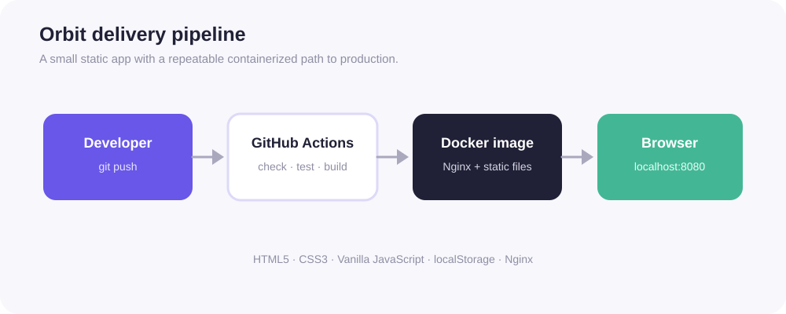
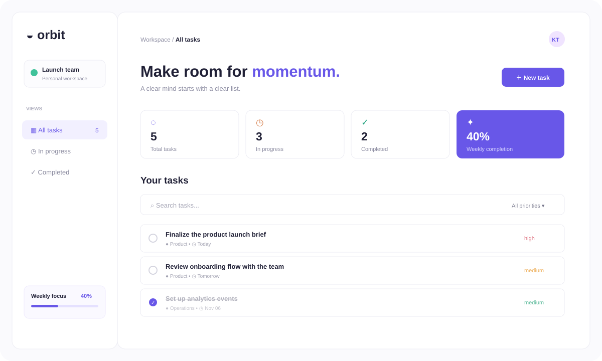

# Orbit Task Dashboard

[](https://github.com/kirantej5/devops-webapp/actions/workflows/ci.yml)
[](Dockerfile)
[](nginx.conf)
[](LICENSE)

A polished, containerized task dashboard for demonstrating a small but complete DevOps workflow. Orbit uses plain HTML, CSS, and JavaScript, stores demo tasks in browser localStorage, and is served by Nginx in a lightweight Docker image.



## Screenshot



The preview shows the responsive dashboard, summary cards, task filters, and task list. Run the app locally or with Docker to interact with it.

## Features

- Create and edit tasks with project, priority, and due date
- Mark tasks complete or active and delete tasks
- Search by title or project
- Filter by task status and priority
- Dashboard totals, completion percentage, and weekly focus progress
- Responsive layout for desktop and mobile screens
- No backend or database required for the demo
- Docker image with Nginx and a container health check
- GitHub Actions validation, smoke test, and Docker build

## Delivery architecture

```text
Developer → GitHub → GitHub Actions → Docker/Nginx → Browser
                         ├── JavaScript syntax check
                         ├── Zero-dependency smoke test
                         └── Docker image build
```

See the visual diagram in [`docs/architecture.svg`](docs/architecture.svg).

## Run locally

### Option 1: Open directly

Open `index.html` in a modern browser. Tasks are saved to that browser's localStorage.

### Option 2: Use a local web server

```bash
npx serve .
```

Then open the URL printed by the command.

### Option 3: Run with Docker

```bash
docker build -t orbit-task-dashboard .
docker run --rm -p 8080:80 orbit-task-dashboard
```

Open <http://localhost:8080>.

Or use Docker Compose:

```bash
docker compose up --build
```

## Validation

Node.js 18+ is needed for the checks:

```bash
npm install
npm run check
```

The check validates JavaScript syntax and confirms that the main UI, task interactions, localStorage persistence, Dockerfile, and Nginx configuration are present. CI also builds the Docker image.

Available scripts are `npm run dev`, `npm run lint`, `npm test`, and `npm run build` (Docker image build).

## Project structure

```text
devops-webapp/
├── index.html                 # Accessible app shell and task modal
├── styles.css                 # Responsive visual system
├── app.js                     # Task state, filters, persistence, interactions
├── Dockerfile                 # Nginx production image
├── docker-compose.yml         # Local container orchestration
├── nginx.conf                 # Static asset and SPA routing rules
├── tests/smoke.test.js        # Dependency-free structural test
├── docs/architecture.svg      # Delivery pipeline diagram
└── .github/workflows/ci.yml  # CI and Docker build
```

## Scope and next steps

This project intentionally uses browser localStorage to keep the demo small and portable. A production version could add authentication, a REST API, a shared database, server-side validation, preview deployments, and a container registry publishing step.

## License

MIT. See [`LICENSE`](LICENSE).
